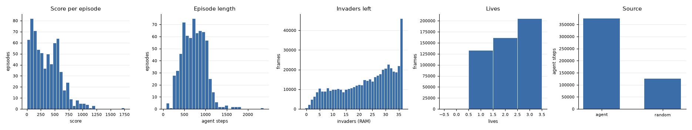
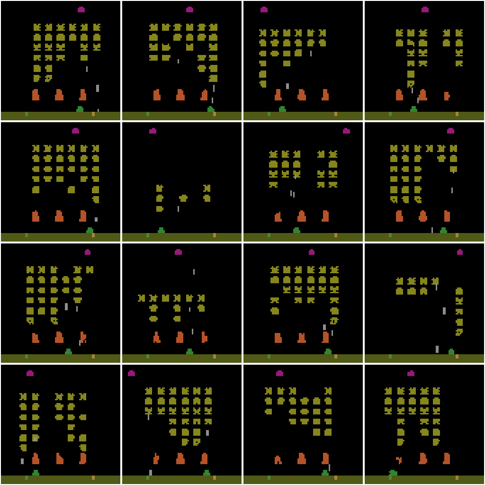
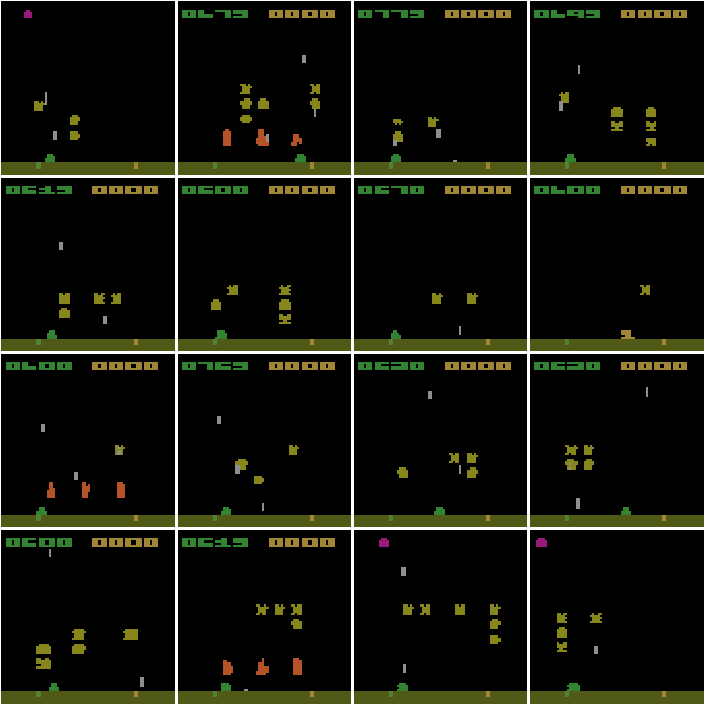
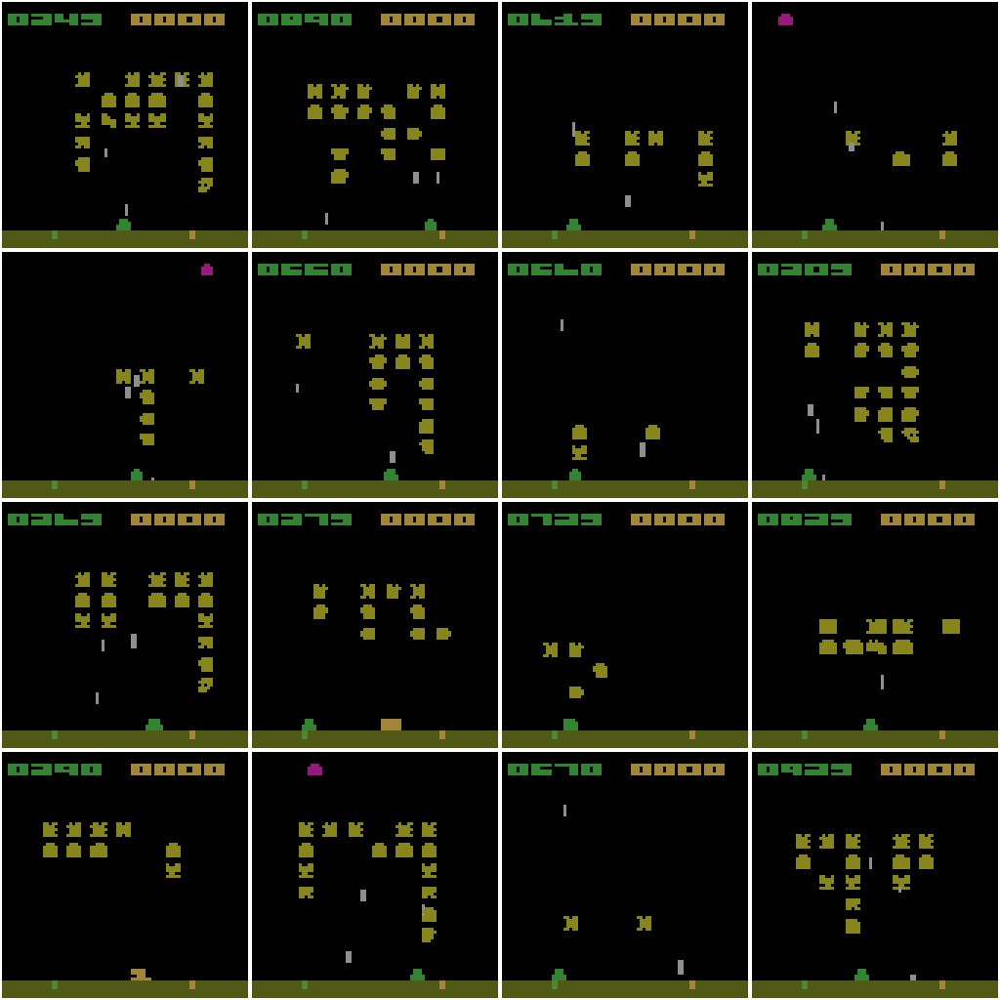
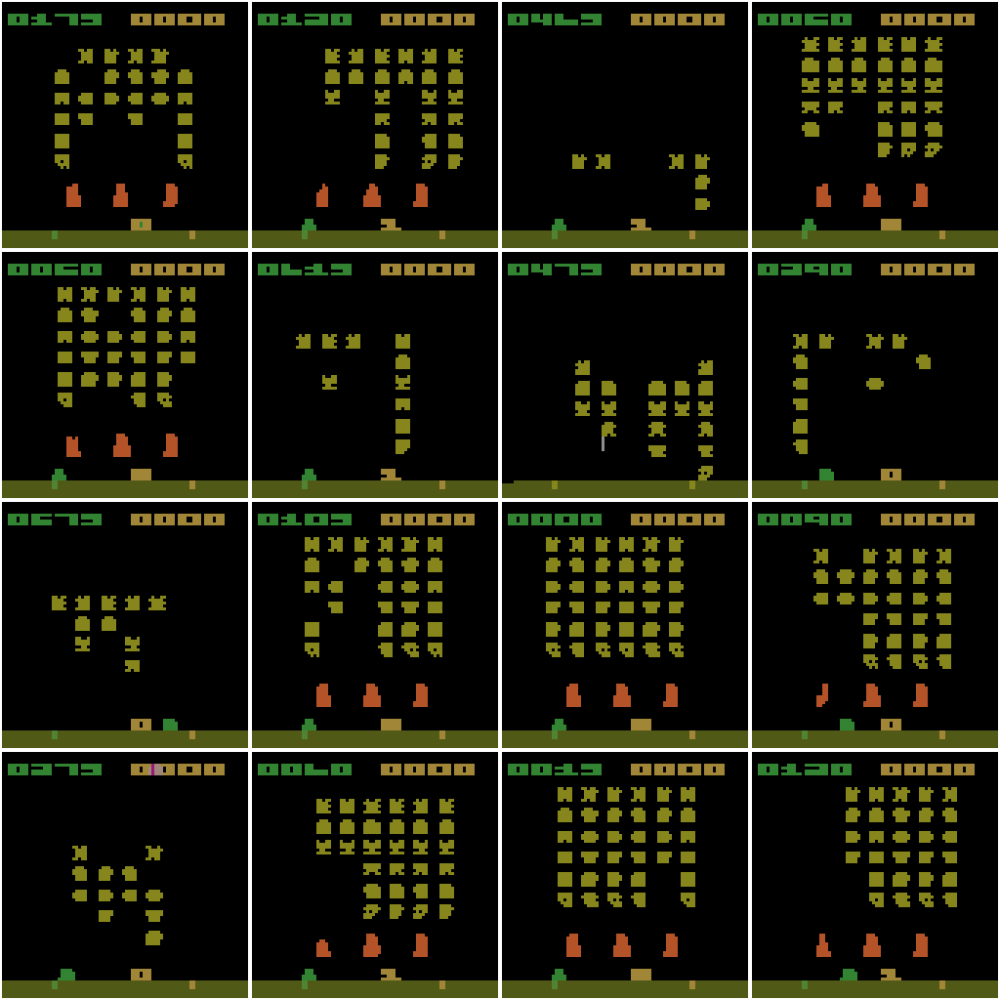
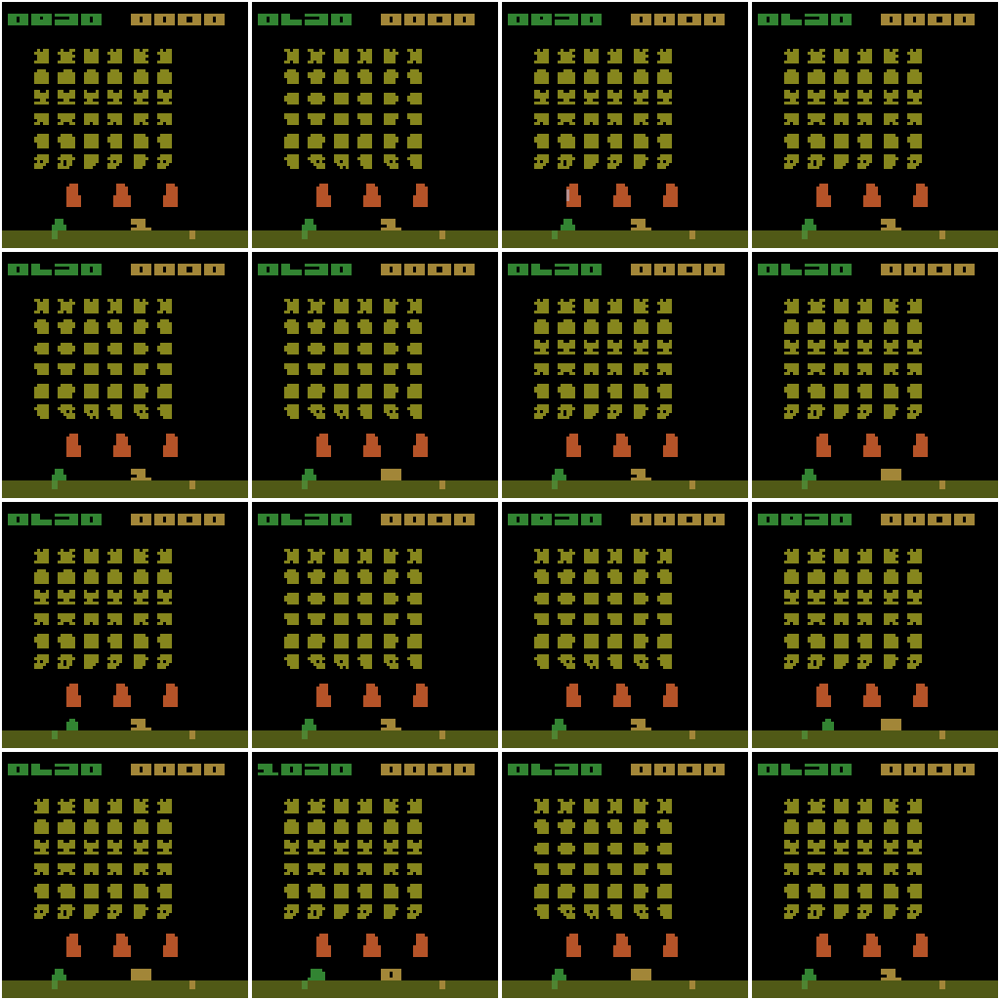
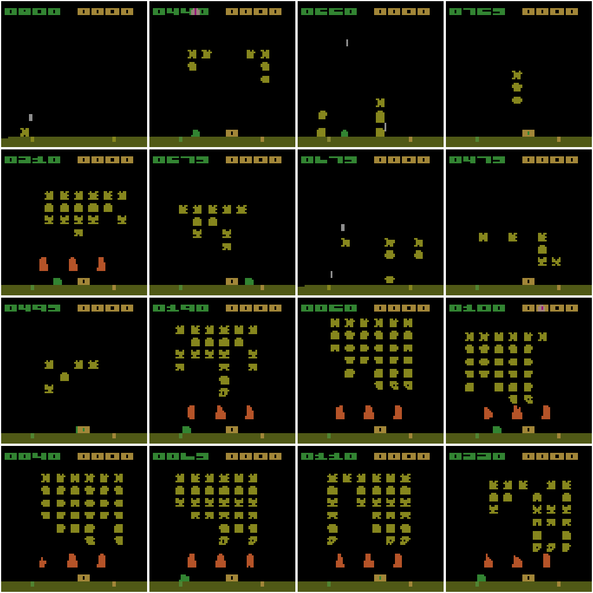

# CP2 coverage report: `data/debug`

Generated by `python scripts/coverage_report.py data/debug`.

12 shards, 500,687 rows, 687 episodes, 500,000 agent steps.

## Targets

| Target | Minimum | Measured | Met |
|---|---|---|---|
| frames with <= 6 invaders left | 5% | 8.48% | yes |
| wave transitions | 50 | 24 | **no** |
| game overs | 200 | 675 | yes |
| frames with the UFO visible | 1% | 17.51% | yes |
| frames with shields <= 50% intact | 10% | 15.26% | yes |

## By source

| Source | Episodes | Agent steps | Mean score | Game overs |
|---|---|---|---|---|
| agent | 456 | 375,000 | 463.8 | 448 |
| random | 231 | 125,000 | 148.2 | 227 |

## Events

- Life losses: 1,958
- Game overs: 675
- Wave transitions (invaders left jumps back up): 24
- Score per episode: mean 357.7, max 1750

## Heuristic checks

- UFO pixel heuristic (magenta in the top band) agrees with RAM[76] >= 4 on 99.93% of frames.
- Shield erosion is shield-colour pixels in the shield band, relative to the episode's first frame.

## Figures

Montages: up to 16 random frames per bucket, 3x nearest, not aspect-corrected.

- `ufo` (16 frames): 
- `few_invaders` (16 frames): 
- `shields_low` (16 frames): 
- `life_lost` (16 frames): 
- `wave_start` (16 frames): 
- `game_over` (16 frames): 
